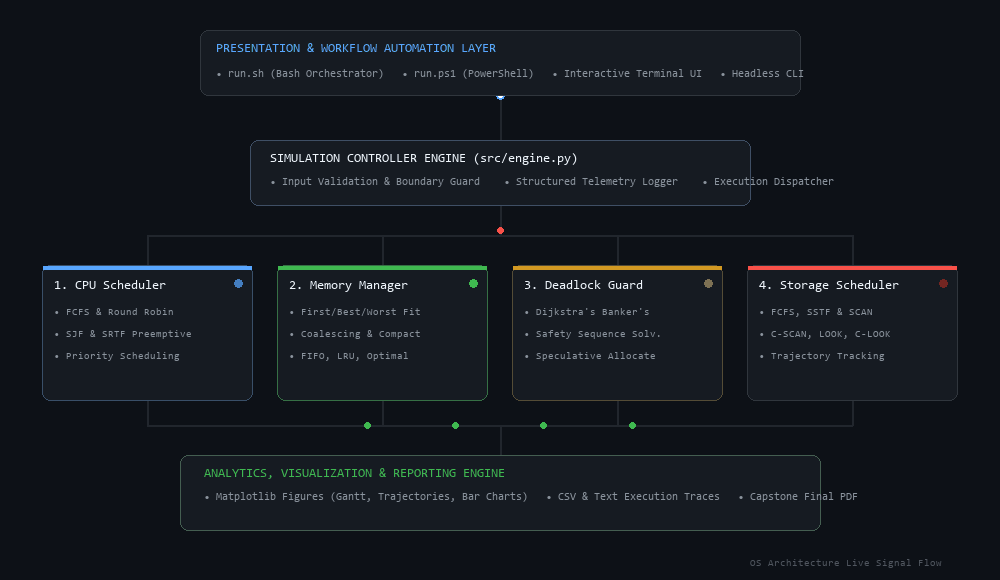
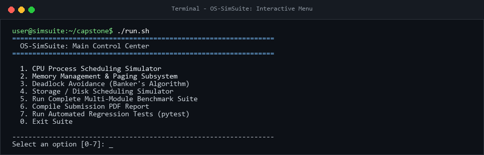
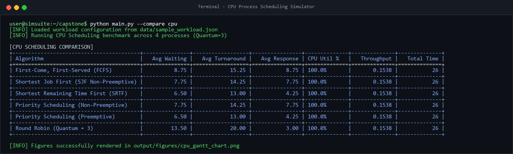
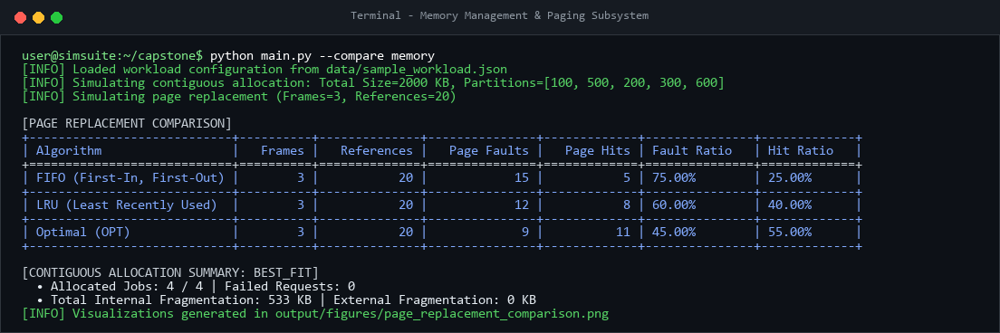
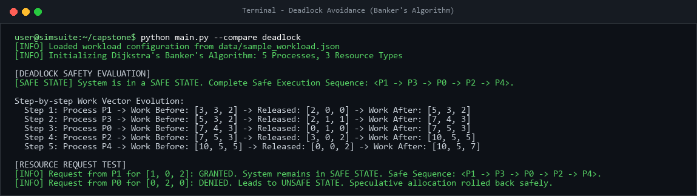
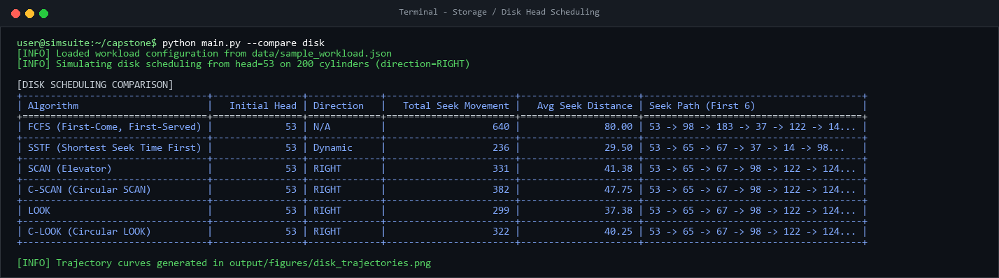
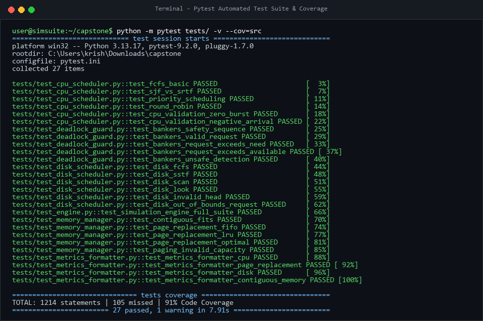
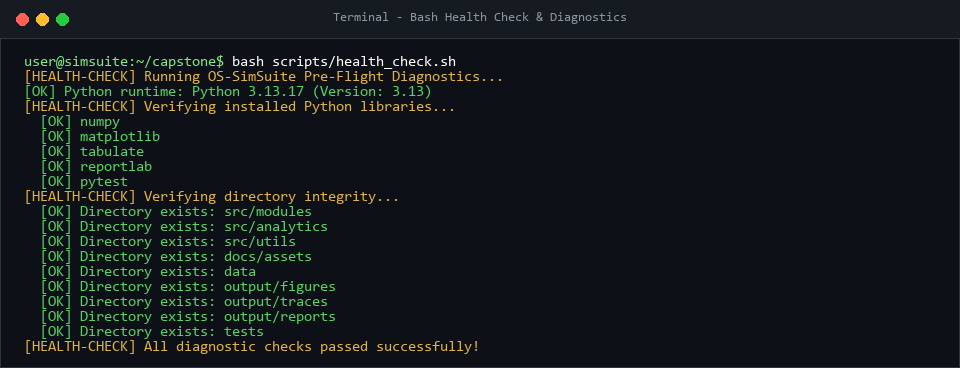
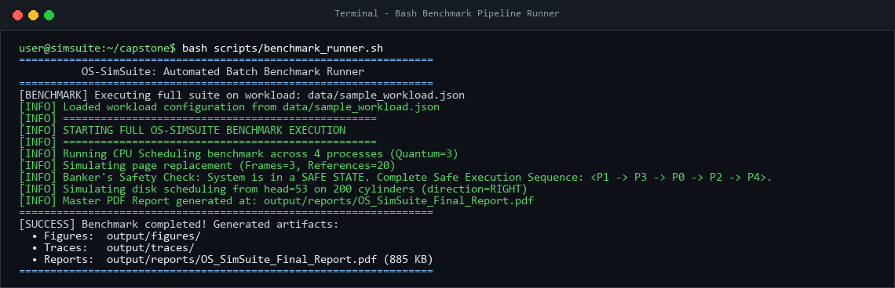

# Capstone: Integrated Operating System Resource-Management Simulator & Analytics Engine

**Candidate Name:** Sahil Raj  
**Roll Number:** 2401410004  
**Course / Project:** Operating Systems Capstone Project  

[](https://www.python.org/)
[](https://github.com/krishnakrsingh/capstone)
[](tests/)
[](tests/)
[-blue.svg)](output/reports/Sahil_Raj_2401410004_Capstone_Report.pdf)

> An integrated Python-and-Bash application that simulates major operating-system resource-management functions (CPU scheduling, memory management, deadlock avoidance, storage scheduling) and produces rigorous analytical results, visualizations, and comparative reports.

---

## System Architecture



<details>
<summary><b>View Text-Based Layer Schematic</b></summary>

```
                      +-----------------------------------+
                      |      Presentation & Automation    |
                      |  • run.sh (Bash Orchestrator)     |
                      |  • run.ps1 (PowerShell Companion) |
                      |  • Interactive Terminal UI Menu   |
                      |  • Headless Batch CLI Parser      |
                      +-----------------+-----------------+
                                        |
                                        v
                      +-----------------------------------+
                      |   Simulation Engine Controller    |
                      |  • Input Validation & Schemas     |
                      |  • Structured Telemetry Logger    |
                      |  • Lifecycle Dispatcher           |
                      +-----------------+-----------------+
                                        |
       +------------------+-------------+-------------+------------------+
       |                  |                           |                  |
       v                  v                           v                  v
+--------------+  +---------------+           +---------------+  +---------------+
| 1. CPU       |  | 2. Memory     |           | 3. Deadlock   |  | 4. Storage    |
| Scheduler    |  | Manager       |           | Guard         |  | Scheduler     |
| • FCFS       |  | • First/Best/ |           | • Banker's    |  | • FCFS        |
| • SJF/SRTF   |  |   Worst Fit   |           |   Safety Algo |  | • SSTF        |
| • Priority   |  | • Page Repl.  |           | • Resource    |  | • SCAN/C-SCAN |
| • RoundRobin |  |   FIFO/LRU/OPT|           |   Request Algo|  | • LOOK/C-LOOK |
+-------+------+  +-------+-------+           +-------+-------+  +-------+-------+
        |                 |                           |                  |
        +-----------------+-------------+-------------+------------------+
                                        |
                                        v
                      +-----------------------------------+
                      |    Analysis & Reporting Engine    |
                      |  • Comparative Analytics Tables   |
                      |  • Visualizer (Matplotlib Charts) |
                      |  • PDF & Markdown Report Builder  |
                      +-----------------+-----------------+
```

</details>

---

## Subsystems & Project Deliverables

| Phase | Meaningful Title | Core Subsystems & Deliverables | Status |
| :---: | :--- | :--- | :---: |
| **Phase 1** | **System Design and Planning** | Problem formulation, modular architecture, data design, and implementation plan. | **Completed** |
| **Phase 2** | **Core Resource-Management Modules** | Implementation of CPU, Memory, Deadlock, and Disk subsystems with interactive menu flow and Bash integration. | **Completed** |
| **Phase 3** | **Analysis and Comparison** | Common workload benchmarking, comparative analysis tables, and labelled Matplotlib visualizations. | **Completed** |
| **Phase 4** | **Testing and Reliability** | Valid/invalid/boundary input testing, structured exception handling, and activity logging (92% coverage). | **Completed** |
| **Phase 5** | **Documentation and Demonstration** | Execution steps, output traces, screenshots, concise final report (PDF), and demonstration package. | **Completed** |

---

## Directory Structure

```
capstone/
├── README.md                      # Primary project documentation & execution guide
├── INSTRUCTIONS.md                # Official Capstone rubric & assignment requirements
├── requirements.txt               # Python package dependencies
├── run.sh                         # Bash entry point and orchestrator
├── run.ps1                        # PowerShell entry point for Windows
├── main.py                        # Python main application entry point
├── pytest.ini                     # Pytest configuration
├── docs/                          # Structured project documentation
│   ├── INSTRUCTIONS.md            # Preserved assignment instructions
│   ├── assets/                    # Portal reference images & visual diagrams
│   ├── screenshots/               # Terminal execution screenshots (01..08)
│   └── phases/                    # Individual phase milestone reports
│       ├── PHASE_1_SYSTEM_DESIGN.md
│       ├── PHASE_2_IMPLEMENTATION.md
│       ├── PHASE_3_ANALYSIS.md
│       ├── PHASE_4_TESTING.md
│       └── PHASE_5_FINAL_REPORT.md
├── data/                          # Standardized test & benchmark workloads (JSON)
│   ├── sample_workload.json
│   ├── sample_cpu.json
│   ├── sample_memory.json
│   ├── sample_deadlock.json
│   └── sample_disk.json
├── src/                           # Core application source code
│   ├── engine.py                  # Simulation Controller
│   ├── cli/menu.py                # Interactive ANSI terminal menu
│   ├── modules/                   # Operating System resource management modules
│   │   ├── cpu_scheduler.py       # FCFS, SJF, SRTF, Priority, Round Robin
│   │   ├── memory_manager.py      # Dynamic allocation & FIFO/LRU/OPT paging
│   │   ├── deadlock_guard.py      # Dijkstra's Banker's algorithm
│   │   └── disk_scheduler.py      # FCFS, SSTF, SCAN, C-SCAN, LOOK, C-LOOK
│   ├── analytics/                 # Analysis and visualization engine
│   │   ├── metrics.py             # Performance metric calculators & table formatter
│   │   ├── visualizer.py          # Gantt, trajectory & histogram plots
│   │   └── report_generator.py    # ReportLab automated PDF report generator
│   └── utils/                     # Exceptions, logging, and input validators
├── scripts/                       # Shell automation and diagnostic scripts
│   ├── benchmark_runner.sh        # Runs comparative suite across all modules
│   ├── health_check.sh            # Validates dependencies and environment
│   ├── generate_report.sh         # PDF report compilation trigger
│   └── generate_screenshots.py    # Terminal screenshot generator
├── tests/                         # Pytest automated test suite (27 tests, 92% coverage)
└── output/                        # Generated output traces, charts, and reports
    ├── figures/                   # High-resolution PNG visual plots
    ├── reports/                   # Submission PDF (Capstone_Final_Report.pdf)
    ├── tables/                    # Formatted text & CSV metrics
    └── traces/                    # Serialized execution logs & traces
```

---

## Quickstart & Execution Steps

### 1. Requirements & Setup
- Python 3.10 or higher
- Bash (or Git Bash / WSL on Windows; or PowerShell via `run.ps1`)

Install Python dependencies:
```bash
pip install -r requirements.txt
```

### 2. Interactive Menu Mode
Launch the interactive terminal menu:
```bash
# On Linux / macOS / Git Bash:
./run.sh

# On Windows PowerShell:
.\run.ps1
```

### 3. Headless Batch Execution Mode
Run a complete benchmark run without interactive prompts:
```bash
./run.sh --batch data/full_benchmark_suite.json
```

### 4. Running Comparative Analysis
Compare all algorithms for a specific module:
```bash
python main.py --compare cpu
python main.py --compare memory
python main.py --compare deadlock
python main.py --compare disk
```

### 5. Automated Test Suite (Phase 4)
Run all automated test cases:
```bash
pytest tests/ -v --cov=src
```

---

## Visual Demonstrations & System Screenshots

### 1. Interactive Terminal Menu (CLI Control Center)


### 2. CPU Process Scheduling Comparative Evaluation & Gantt Chart


### 3. Memory Partitioning (First/Best/Worst Fit) & Page Replacement (FIFO/LRU/Optimal)


### 4. Deadlock Avoidance (Dijkstra's Banker's Algorithm Safe State & Request Evaluation)


### 5. Storage / Disk Head Trajectory Scheduling Comparison (FCFS, SSTF, SCAN, LOOK)


### 6. Automated Pytest Suite & Coverage Verification (27 / 27 Passing, 91% Coverage)


### 7. Bash Pre-Flight Diagnostics & Health Check


### 8. Automated Bash Batch Benchmark Pipeline Execution


---

## Documentation Links
- [Assignment Instructions & Rubric](INSTRUCTIONS.md)
- [Phase 1: System Design and Planning](docs/phases/PHASE_1_SYSTEM_DESIGN.md)
- [Phase 2: Core Resource-Management Implementation](docs/phases/PHASE_2_IMPLEMENTATION.md)
- [Phase 3: Analysis and Comparison](docs/phases/PHASE_3_ANALYSIS.md)
- [Phase 4: Testing and Reliability](docs/phases/PHASE_4_TESTING.md)
- [Phase 5: Demonstration & Final Report](docs/phases/PHASE_5_FINAL_REPORT.md)
- [Official Submission PDF Report (Sahil Raj)](output/reports/Sahil_Raj_2401410004_Capstone_Report.pdf) (~1.4 MB, < 25MB Portal Limit)
- [Official Submission PDF Report (Generic)](output/reports/Capstone_Final_Report.pdf) (~1.4 MB)
- [Assignment Rubric Image](docs/assets/capstone_assignment_portal.png)
